

  <a href="README.md">简体中文</a> · <b>English</b>

  <picture>
    <source media="(prefers-color-scheme: dark)" srcset="docs/assets/hero-en-dark.webp">
    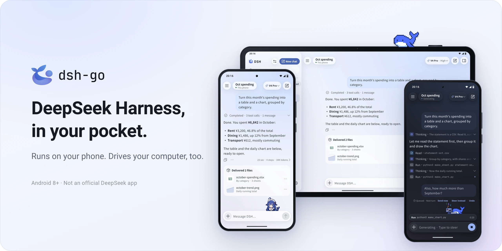
  </picture>

  An Android client for DeepSeek Harness. Run DSH right on your phone, or drive the one on your computer.

  
  
  
  

 

<h3 align="center">Deepy and Whale girl keep you company</h3>

They code, flip, wave and nap along with DSH, and can follow you to the home screen.

  <picture><source media="(prefers-color-scheme: dark)" srcset="docs/assets/pet-deepy-typing-en-dark.gif">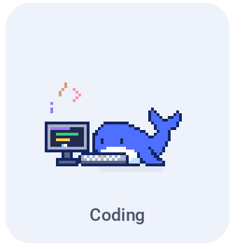</picture> <picture><source media="(prefers-color-scheme: dark)" srcset="docs/assets/pet-deepy-happy-en-dark.gif">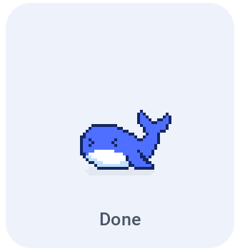</picture> <picture><source media="(prefers-color-scheme: dark)" srcset="docs/assets/pet-deepy-notification-en-dark.gif">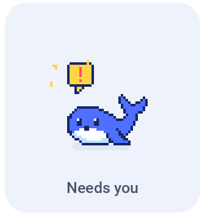</picture> <picture><source media="(prefers-color-scheme: dark)" srcset="docs/assets/pet-deepy-sleeping-en-dark.gif">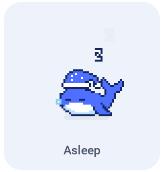</picture>

  <picture><source media="(prefers-color-scheme: dark)" srcset="docs/assets/pet-girl-typing-en-dark.gif">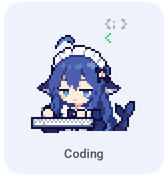</picture> <picture><source media="(prefers-color-scheme: dark)" srcset="docs/assets/pet-girl-happy-en-dark.gif"></picture> <picture><source media="(prefers-color-scheme: dark)" srcset="docs/assets/pet-girl-notification-en-dark.gif"></picture> <picture><source media="(prefers-color-scheme: dark)" srcset="docs/assets/pet-girl-sleeping-en-dark.gif">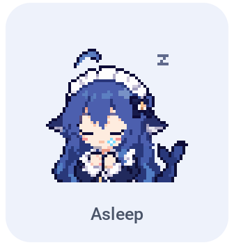</picture>

 

<h3 align="center">Join the group to get the beta</h3>

Beta builds are shared in the groups, mainly QQ. Public beta next week, with the main repo going public.

  <a href="https://qm.qq.com/q/OEy2RqZnqY"><picture><source media="(prefers-color-scheme: dark)" srcset="docs/assets/qr-qq-en-dark.webp">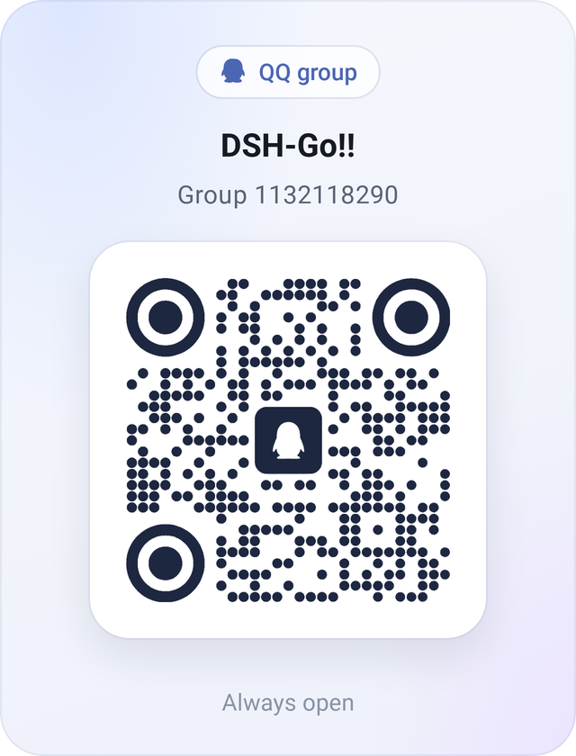</picture></a>&emsp;&emsp;<picture><source media="(prefers-color-scheme: dark)" srcset="docs/assets/qr-wechat-en-dark.webp">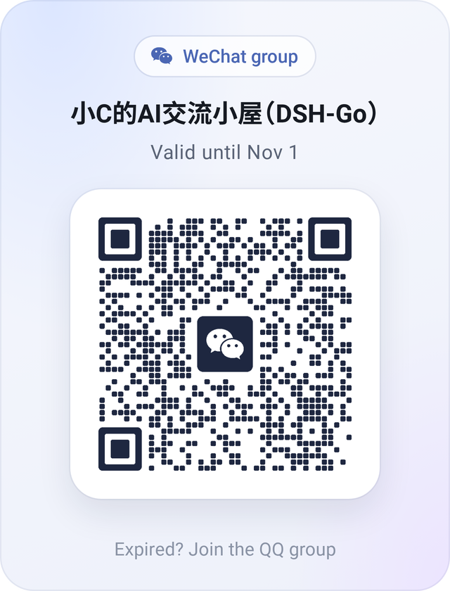</picture>

  QQ group <code>1132118290</code>. On a computer, <a href="https://qm.qq.com/q/OEy2RqZnqY">join with one click</a>. The WeChat code changes every week; if it has expired, join the QQ group. 
  If you installed an early test build, uninstall it first: release builds are signed with a new key.

 

<h3 align="center">Runs on your phone. Drives your computer.</h3>

A Linux environment built in, no root and no Termux. Switch to the DSH on your computer in one tap.

  <picture>
    <source media="(prefers-color-scheme: dark)" srcset="docs/assets/f-remote-en-dark.webp">
    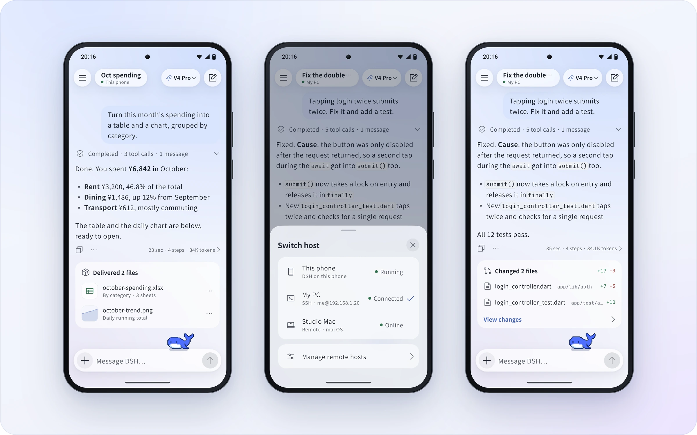
  </picture>

 

<h3 align="center">Chime in, interrupt, stay tidy</h3>

Send a message while DSH is replying, and tap "Send now" whenever you like. Finished steps fold into one line.

  <picture>
    <source media="(prefers-color-scheme: dark)" srcset="docs/assets/f-steer-en-dark.webp">
    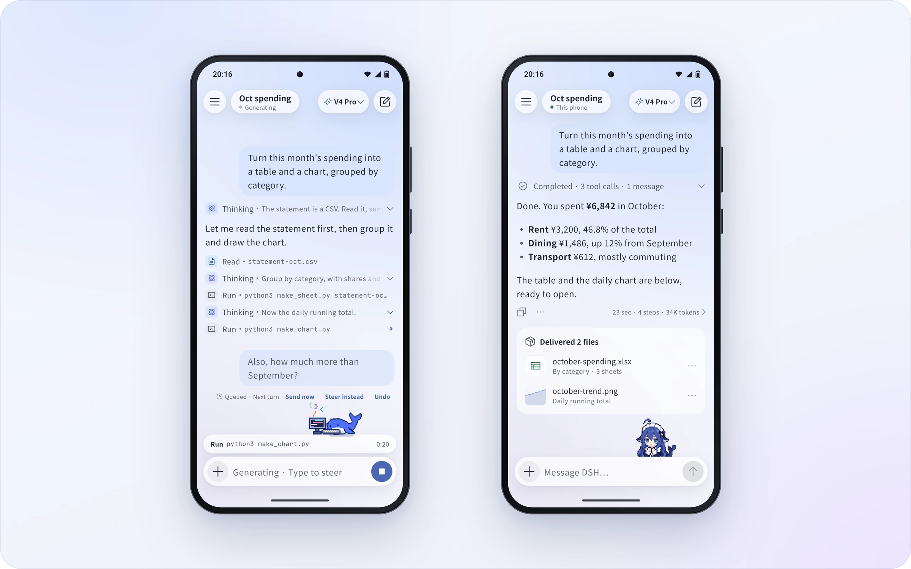
  </picture>

 

<h3 align="center">Native, with the web interface one tap away</h3>

Switch between the native app and the official web interface on the same chat. It reopens in whichever you used last.

  <picture>
    <source media="(prefers-color-scheme: dark)" srcset="docs/assets/f-web-en-dark.webp">
    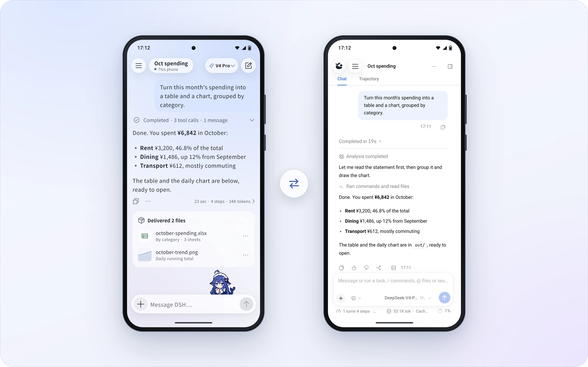
  </picture>

 

<h3 align="center">Share cards, replays and links</h3>

Turn a reply into a share card. Share a whole chat as a link that replays in any browser, end-to-end encrypted.

  <picture>
    <source media="(prefers-color-scheme: dark)" srcset="docs/assets/f-share-en-dark.webp">
    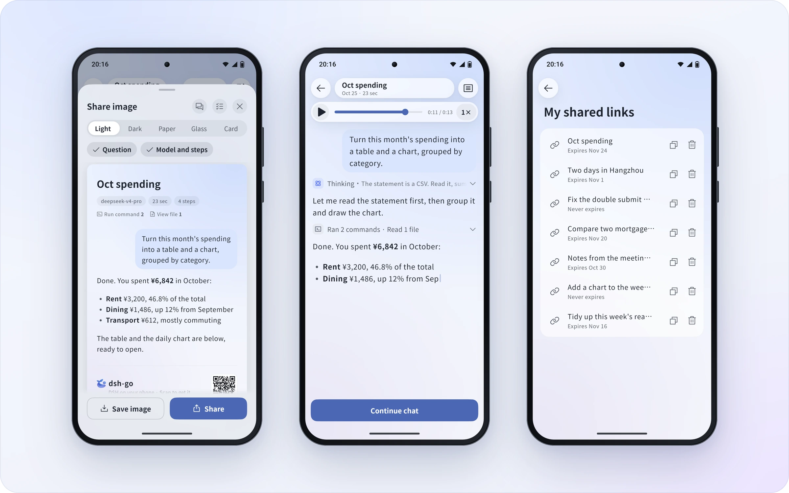
  </picture>

 

<h3 align="center">Landscape and tablets</h3>

New layouts for landscape phones and tablets: the sidebar stays, content stays centered, the keyboard never crowds.

  <picture>
    <source media="(prefers-color-scheme: dark)" srcset="docs/assets/f-adaptive-en-dark.webp">
    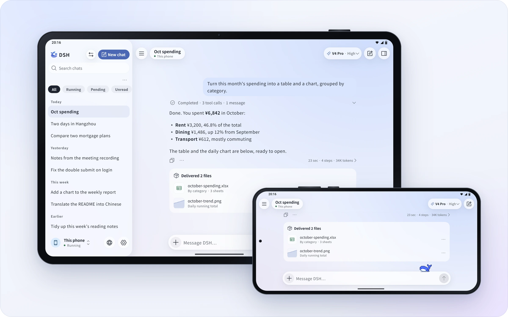
  </picture>

 

<h3 align="center">Colors and home screen icons</h3>

Six accent colors, your wallpaper's, or your own. Four home screen icons and three icon styles.

  <picture>
    <source media="(prefers-color-scheme: dark)" srcset="docs/assets/f-theme-en-dark.webp">
    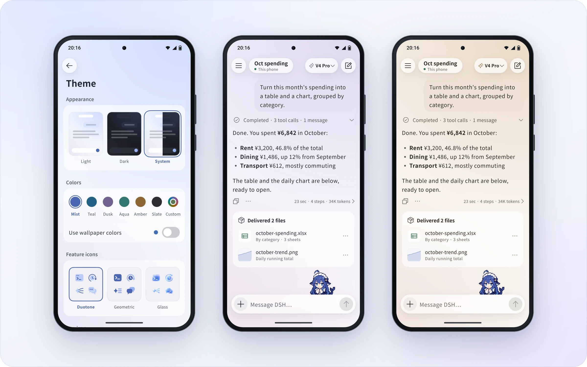
  </picture>

 

<h3 align="center">English and 中文</h3>

The whole app speaks both. It follows your system, or pick one in Settings.

  <picture>
    <source media="(prefers-color-scheme: dark)" srcset="docs/assets/f-lang-dark.webp">
    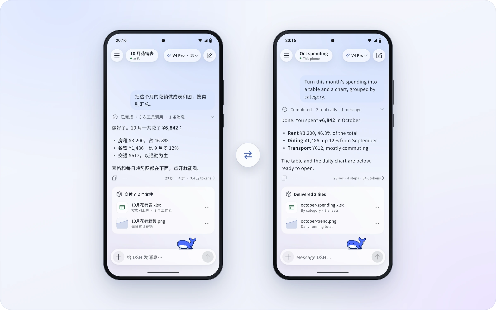
  </picture>

 

<h3 align="center">Phone control</h3>

DSH reads the screen and taps for you. Payments, passwords and codes always stay with you.

  <picture>
    <source media="(prefers-color-scheme: dark)" srcset="docs/assets/f-phone-en-dark.webp">
    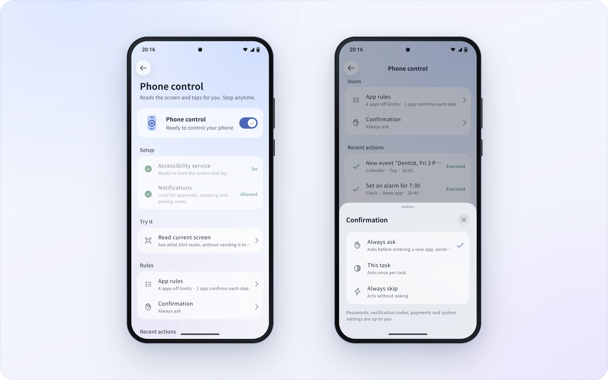
  </picture>

 

## FAQ

<b>Is this an official DeepSeek app?</b>

 

No. dsh-go is an unofficial client made by the community, built on the open-source [DeepSeek Harness](https://github.com/deepseek-ai/deepseek-harness). DSH itself runs on your phone; the model runs in DeepSeek's cloud, so it needs a connection and bills your account.

<b>Is it safe?</b>

 

The local web interface only answers to the app itself. Shared links are end-to-end encrypted: the key lives only in the link, and the server never sees the content. Phone control always hands payments, passwords, codes and system settings back to you.

<b>Will the system kill it in the background?</b>

 

Some battery savers hold apps back. When that happens, dsh-go tells you and opens the right setting, on vivo, Xiaomi, Huawei, Honor and OPPO.

<b>What phone do I need?</b>

 

Android 8 or later on arm64. The first launch sets up the built-in environment; keep about 1 GB free.

<b>Is it open source?</b>

 

Yes. The main code repository goes public with the public beta next week, under AGPL-3.0. The dsh-go name and logo, and the mascots Deepy and Whale girl, remain all rights reserved.

## Community

- **Forum**: [forum.dshtui.com](https://forum.dshtui.com)
- **QQ group**: `1132118290` ([join](https://qm.qq.com/q/OEy2RqZnqY))
- **WeChat group**: scan the [code above](#join); if it has expired, join the QQ group
<!-- Telegram: link to come, add a line here -->

## Thanks

- [DeepSeek Harness](https://github.com/deepseek-ai/deepseek-harness): the agent dsh-go runs and connects to.
- [DSH-TUI](https://github.com/ccch1mneyyy/dsh-TUI): home of the mascots, Deepy and Whale girl.

## License

Code will be open-sourced under AGPL-3.0 (public at the public beta) · Brand and mascots: all rights reserved

 

dsh-go is an unofficial client made by the community. It is not affiliated with or endorsed by DeepSeek. DeepSeek names and marks belong to their owners.

