# Components

A plugin view is a JSON tree of components, each `{ "type": name, …properties }`. V1 has sixteen: the first ten are the same as the model's `dsh-ui` cards, the last six are plugin-only; v2 adds 26 (inputs, structure, the empty state and the gallery). Spec: [`docs/design/native-plugins-views.md`](../../design/native-plugins-views.md); machine-readable: [`sdk/plugin-kit/schema/view.schema.json`](../../../sdk/plugin-kit/schema/view.schema.json).

The screenshots are the app's golden test images (light / dark, 390 wide), drawn by the same code as on a phone.

## V2 styles

Set `v: 2` at the root for semantic font sizes, weights, rich spans and readable colours, plus card variants, spacing, alignment and proportional columns. See [Styles](styles.md) for syntax, budgets and compatibility. Omitting the version preserves v1 rendering.

## Layout and text

| Component | Properties | Notes |
|---|---|---|
| `stack` | `children`: components | Vertical. The root may also carry `title` (the tool card's collapsed summary) and `v: 1` |
| `row` | `children` | Horizontal; columns sized by the widest child, wraps on narrow screens, columns align |
| `text` | `text`; `tone?: muted` | A paragraph. Plugin views take paragraphs, line breaks, `**bold**`, `` `code` ``; links show as text |
| `callout` | `text`; `tone?: info\|good\|warn\|bad` | A notice |
| `steps` | `items: [{ label, status: done\|current\|todo\|failed, detail? }]` (≤ 12) | Steps; an item may be a plain string (todo) |
| `compare` | `items: [{ title, badge?, rows: [[name, value]] }]` (2–4 items, ≤ 8 rows each) | Stacked comparison cards; `rows` may be `{ name: value }` |

| Light | Dark |
|---|---|
| 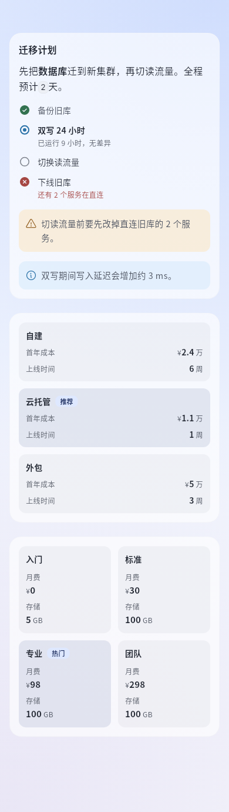 | 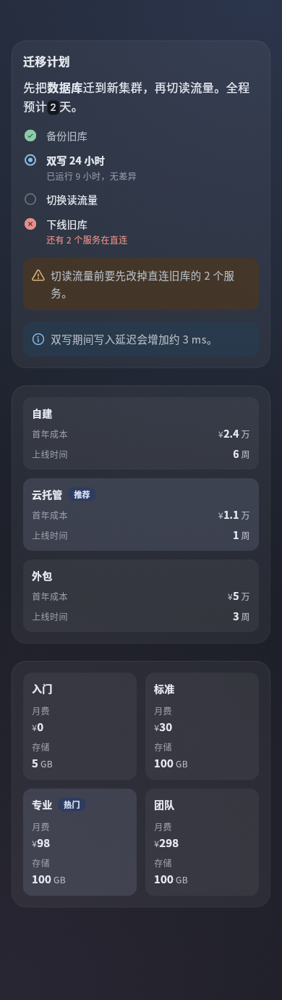 |

## Numbers and charts

| Component | Properties | Notes |
|---|---|---|
| `metric` | `label`, `value`; `tone?: good\|warn\|bad\|info`; `caption?` | One key number; thousands separators from 10,000; smaller unit, tabular digits |
| `chart` | `kind: bar\|hbar\|line\|donut`; `categories`; `series: [{ name?, values }]`; `unit?`; `caption?` | ≤ 60 points, ≤ 6 series; donuts draw the first series; `null` leaves a gap |
| `progress` | `value`; `max?` (default 100); `label?`; `caption?`; `tone?` | One bar; `caption` defaults to the percentage |

| Light | Dark |
|---|---|
| 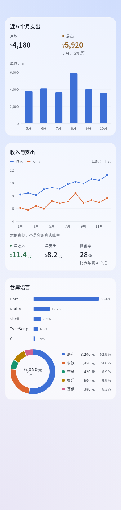 | 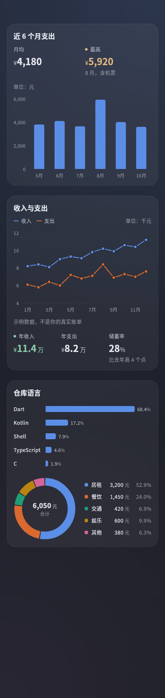 |

## The six plugin-only components

| Component | Properties | Limit | Notes |
|---|---|---|---|
| `list` | `items: [{ title, subtitle?, trailing?, icon?, tone?, action? }]` | 50 rows | Rows; `trailing` is the value at the end; rows with `action` are tappable and get a chevron |
| `keyValue` | `items: [[name, value]]`, `[{ label, value, tone? }]` or `{ name: value }` | 24 | "name …… value", values right-aligned, tabular digits |
| `progress` | see above | — | — |
| `table` | `columns: [text \| { label, align?: start\|end }]`; `rows: [[cell]]` | 8 columns, 50 rows | All-number columns right-align; scrolls sideways when wide |
| `actions` | `items: [{ label, action, icon?, style?: primary\|plain }]` | 4, one primary | 1–2 side by side, 3–4 stacked |
| `image` | `src`; `alt?`; `aspect?` (width / height, 0.25–4); `caption?` | `data:` ≤ 64 KiB; side ≤ 4096, ≤ 4 M pixels | `src` is `asset:icons/a.png` (png / jpg / webp / gif in the manifest's `assets` directory) or `data:image/…;base64,…` |

| Light | Dark |
|---|---|
| 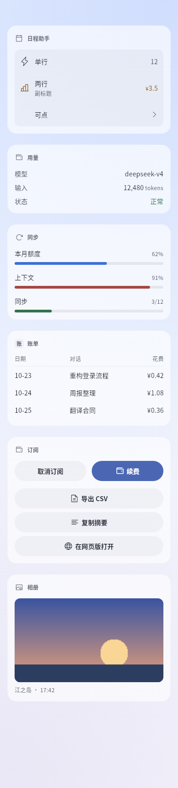 | 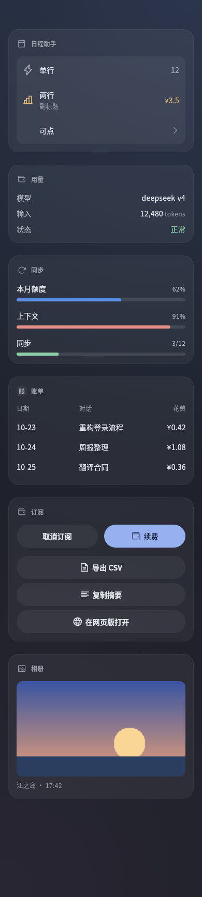 |

## Empty state, gallery, ring progress, trend line (v2)

Only with `v: 2` at the root. An older app does not know `emptyState` or `gallery` and draws a grey placeholder; it ignores `progress.shape` and `metric.trend` and draws the bar and the figure as before. To serve older apps, use the SDK's `adaptView(view, caps)`: a gallery becomes `image`s in a `grid` (stacked where there is no `grid`), an empty state a `callout` with its button.

| Component / property | Shape | Limits | Notes |
|---|---|---|---|
| `emptyState` | `title`; `message?`; `icon?`; `action?: { label, action, icon? }` | title 40, message 120, button 12 characters; one button at most | The app's own empty look: a 48 round badge (in the view's accent), the title, one line and an outlined button as wide as its words, centred. No button in a tool card |
| `gallery` | `items: [{ src, alt?, caption?, action? }]`; `columns?: 2–4`; `aspect?: 0.5–2` (width / height, default 1) | 24 pictures in a panel, 8 in a tool card; `src` as for `image` | Equal cells 8 apart, corners 8. Without `columns`: 3 when the content is 320 wide or more, else 2; fewer while a cell would be under 72. A row where any cell has a `caption` keeps room for one in every cell. A cell with an `action` goes to the plugin; any other tap, and a long press on any cell, opens the app's picture viewer (swipe through the set, pinch to zoom; saving and sharing are the app's own actions, never the plugin's). A cell whose `src` is not allowed draws a quiet placeholder and stays out of the viewer |
| `progress`'s `shape` | `"bar"` (default) \| `"ring"` | — | A ring 64 across, 6 thick, the percentage (or `caption`) in the middle, `label` centred under it; centred in its column in a `row` / `grid` |
| `metric`'s `trend` | 2–30 numbers, `null`s allowed | 30 points | A line 24 high and as wide as the metric under its value, in its tone or the accent; `null` breaks it, the last point gets a dot; no axes, no numbers |

| Light | Dark |
|---|---|
| 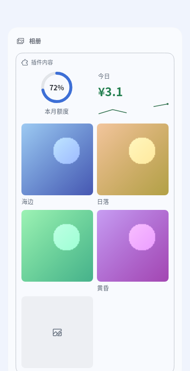 | 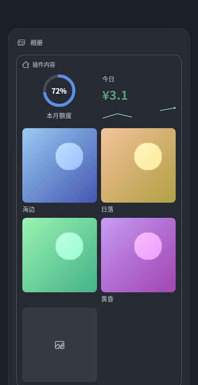 |
| 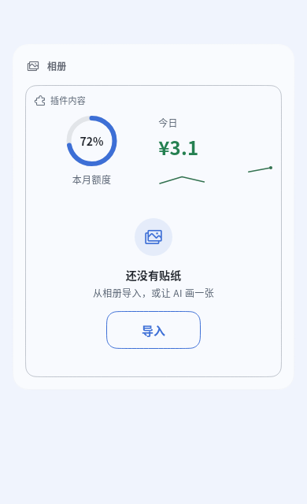 | 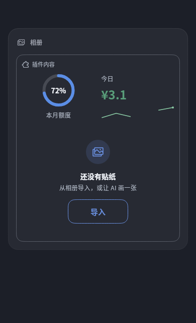 |

```json
{ "v": 2, "type": "stack", "accent": "app", "children": [
  { "type": "row", "children": [
    { "type": "progress", "shape": "ring", "value": 72, "label": "This month" },
    { "type": "metric", "label": "Today", "value": "¥3.1", "tone": "good", "trend": [1.2, 2.0, 1.4, null, 2.6, 3.1] }
  ]},
  { "type": "gallery", "items": [
    { "src": "asset:stickers/sea.webp", "alt": "Sea", "caption": "Seaside" },
    { "src": "asset:stickers/sunset.webp", "alt": "Sunset", "action": { "id": "pick", "args": { "id": "sunset" } } }
  ]}
]}
```

## Options and confirm

| Component | Properties | Tap |
|---|---|---|
| `options` | `id`; `options: [{ label, description?, value? }]` (≤ 8, plain strings allowed); `multi?`; `selected?` | Invokes `id` with `value: { value }` (multi: `{ values }`); the checked state follows the `selected` you push |
| `confirm` | `id`; `confirmLabel?`, `cancelLabel?` (≤ 12) | Invokes `id` with `value: { confirmed: true \| false }` |

A plugin panel (metrics, progress, list, buttons, options, text, notice):

| Light | Dark |
|---|---|
| 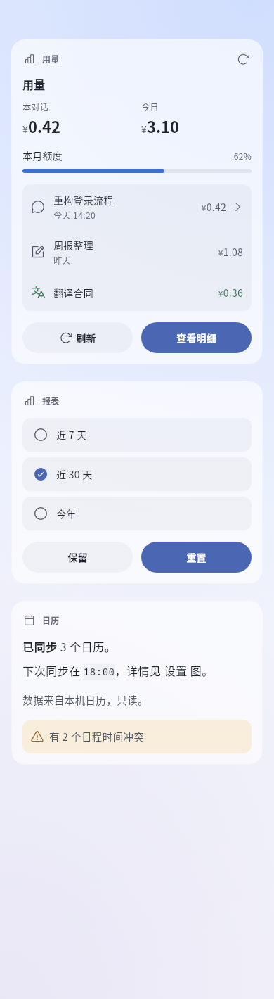 | 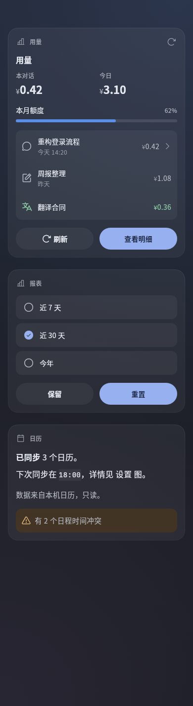 |

## Tool cards

The card in a tool row; collapsed, the row shows the view's `title`. Not tappable in phase 0: buttons and confirms are hidden, options are read-only.

| Light | Dark |
|---|---|
| 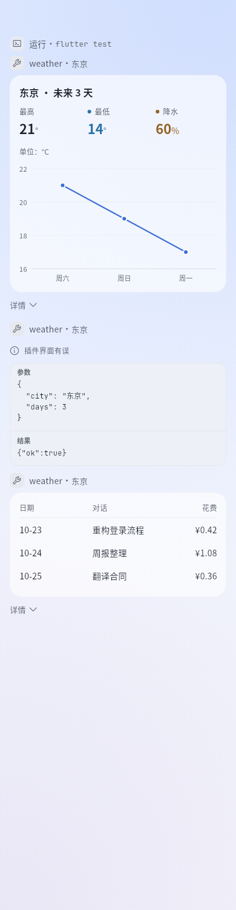 | 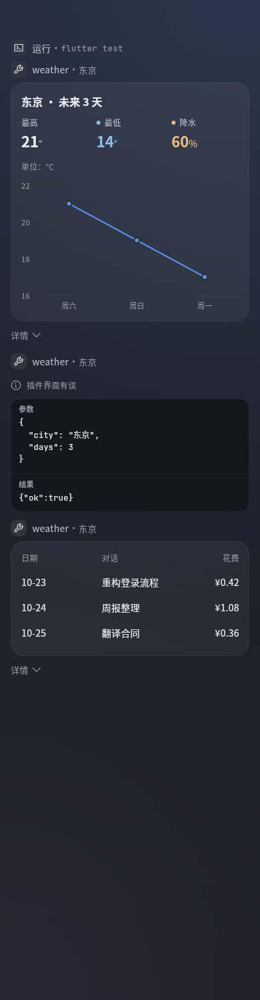 |

## Errors and empty states

| Case | Shows |
|---|---|
| A wrong child (unknown `type`, missing required property) | That child becomes a grey "Can’t display this section"; the rest draws |
| Broken root, view too large, nesting too deep | One line "Plugin view has an error" |
| An array-taking component gets `[]` or a missing binding | "No data yet" — not an error |
| A bound text is missing | "—" |
| An image source is invalid or undecodable | A placeholder "Can’t display image" |

| Light | Dark |
|---|---|
| 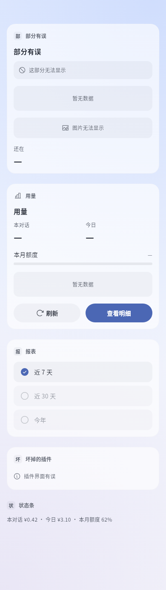 | 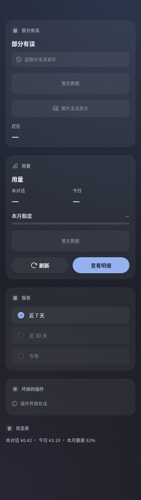 |

## Common rules

| Item | Rule |
|---|---|
| Text properties | Strings; numbers show as text (thousands separators from 10,000) |
| Tones | `good` `warn` `bad` `info` `muted`; aliases `success` `warning` `danger` `error` `note` `secondary` work too. The app picks the colours |
| Icons | bolt star sparkle heart flag bookmark pin bell clock alarm calendar todo note document folder search code terminal globe chart lightbulb book puzzle robot chat mail translate image camera mic link summary wrench bug travel school home play refresh archive team wallet palette coin money speaker read copy quote share edit write save paste add remove delete clear fork regenerate reply select-text qr download downloads external info warning check done success error question pending running tip list table panel sidebar menu more expand collapse file folder-open workspace storage pdf zip slides article text diff gallery audio music video video-file play-video pause stop replay generate-image generate-video diagram plugin bot agent skill model tool workflow goal plan job automation command trajectory web web-search browser history time today timezone schedule repeat reminder user account group chats mention invite announcement reaction poll notification send community forum feedback wechat qq telegram discord phone computer cloud server power restart retry theme color text-size pet featured badge favorite settings (162 in all; no locks, keys or shields); unknown names draw a default icon |
| Unknown properties | Ignored in v1; unknown or reserved v2 style fields are ignored with diagnostics |
| Bindings | Any value may be `{ "$": "data.a.b" }` or `data.rows[0].name`, read from the pushed data; `type` cannot be bound. Tool cards have no data |
| Actions | `"action": "id"` or `{ "id": "open", "args": { … } }`, `args` ≤ 1 KiB |

## Limits

| Item | Tool card | Panel | Strip |
|---|---|---|---|
| View size (JSON) | 8 KiB | 32 KiB | 2 KiB |
| Components / depth | 40 / 6 | 120 / 8 | 8 / 3 |
| Children per `stack` / `row` | 16 | 32 | 4 |
| Text / label | 2000 / 200 | 2000 / 200 | 200 |

Too large, or nested deeper than 64: the whole block falls back. Everything else is cut with a small note under the cut component. That is what `check` reports, in the words of the app's plugin details page.

## View-v2 inputs and structure

The 24 input and structure components, forms, two-way bindings, bounded arithmetic, scheduling and profile budgets are documented in [Inputs, forms and local state](inputs.md); the empty state and the gallery are above. The [workbench example](../../../examples/plugins/dsh-go-example-workbench/) is runnable.
